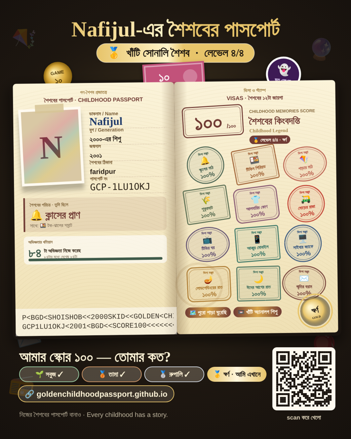

# ✦ Golden Childhood Passport

**Every childhood has a story.**

An interactive Bengali web experience: you spend one day back in your childhood, from morning school bells to load-shedding nights, and leave with a personalized **Childhood Passport** you can download and share.

🔗 **Live:** [goldenchildhoodpassport.github.io](https://goldenchildhoodpassport.github.io)



---

## How it works

| Step | Page | What happens |
|---|---|---|
| 1. Welcome | `index.html` | An animated "door to childhood" intro, then a playful passport application (nickname, birth year, hometown) |
| 2. A day in childhood | `quiz.html` | 12 places from morning to night, each with full-page animated scenes, sounds and hands-on mini-games instead of a plain quiz |
| 3. The passport | `passport.html` | The passport opens, visa stamps land, a scratch card reveals the score, and you get your level, title, badges and a shareable image |

## Features

- **Era-aware scoring.** Questions are weighted by the decades when *you* were 5–14, so a 90s kid and a 2000s kid are scored fairly.
- **4 passport levels.** 🌱 Green → 🥉 Bronze → 🥈 Silver → 🥇 Gold, shown with a level ladder and "points to next level".
- **23 badges** with common / rare / legendary rarity, plus a personality title and a "childhood identity".
- **Shareable image (1080×1350).** Drawn with the Canvas API. Includes the rank, a QR code and the site link, so every shared image brings new visitors.
- **Share links without a backend.** The whole passport is encoded in the URL hash.
- **Sound with no audio files.** Every sound is generated in code with the Web Audio API.
- **Passport details.** Leather cover, foil, hologram, ink visa stamps, a UV-torch hidden layer, page turns, a memory album and phone-tilt support.
- **Private by design.** Everything stays in the visitor's browser (localStorage). Nothing is sent to a server.

## Tech stack

- HTML5, CSS3, vanilla JavaScript (no framework, no build step)
- Canvas API for image export, Web Audio API for sound
- [qrcode-generator](https://github.com/kazuhikoarase/qrcode-generator) (MIT) for QR codes
- Hosted on GitHub Pages

## Project structure

```
index.html · quiz.html · passport.html
css/            page styles (welcome, journey, scenes, moments, passport…)
js/
  config.js     site URL used in QR codes and share links
  data/         questions, journey (12 places), scenes, moments, badges, titles, tiers
  modules/      quiz engine, scoring, badges, sound, scenes, passport, report (image + share)
  vendor/       qrcode.js
assets/images/  backgrounds and illustrations
```

## Run locally

No install needed. Serve the folder with any static server, for example:

```bash
python3 -m http.server 8000
```

Then open `http://localhost:8000`. (Opening the file directly with `file://` will not load `js/app.js`, which is an ES module.)

VS Code's **Live Server** extension works too.

## Author

**Md Nafijul Islam** · [GitHub](https://github.com/mdnafijulislam)
